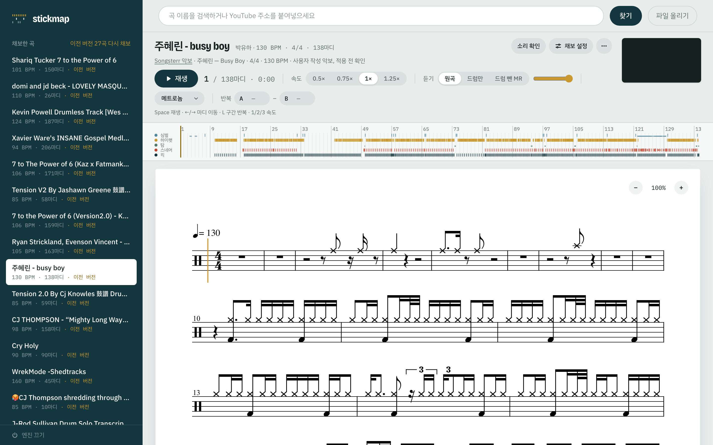

# stickmap

드럼 연습하려고 만든 자동 채보 도구. 유튜브 주소나 오디오 파일을 넣으면 드럼 악보 초안(MusicXML, MIDI, PDF)이 나오고, 웹 화면에서 원곡 영상과 악보를 같이 틀어 놓고 따라 칠 수 있다.

Automatic drum transcription for practice: song in, draft drum score out, with a web player that keeps the video and the score in sync.



## 만든 이유

가스펠 찹이나 라이브 잼 영상에 나오는 필은 악보를 구할 데가 거의 없다. 귀로 따는 건 느리고, 공개된 드럼 채보 모델을 그대로 돌려 보면 빠른 필에서 탐과 스네어를 많이 놓쳤다. 완벽한 악보까지는 아니어도 고쳐 쓸 만한 초안이 빨리 나오면 연습 시간이 많이 줄어들 것 같아서 시작했다.

## 어떻게 동작하나

```
오디오 → 드럼 분리(Demucs) → 박 추적(beat_this) → 타격 검출(ADTOF, 직접 미세조정)
      → 보정 규칙 → 양자화 → MusicXML / MIDI / PDF
```

검출 자체는 공개 모델을 가져다 썼다. 시간을 많이 쓴 건 그 뒤쪽이다.

- 빠른 연타에서 뒤쪽 타격이 사라지는 문제, 스네어와 탐이 동시에 맞을 때 탐이 지워지는 문제를 따로 처리한다. 동시 타격 판별은 작은 gradient boosting 분류기로 했다(420곡 기준 탐 F1 80.7 → 82.4).
- 탐 높낮이는 처음에 주파수 절대값으로 나눴는데 킷마다 튜닝이 달라서 자주 틀렸다. 지금은 한 곡 안의 탐 소리끼리 비교해서 high/mid/low를 정한다.
- 고스트 노트는 곡마다 드럼 스템을 그 킷 소리로 분해(NMFD)해서 스네어 세기를 재고, 그 곡의 보통 스네어보다 확실히 작을 때만 괄호를 친다.
- 양자화 단계에서 박 추적이 두 배로 튀거나 빠진 곳을 고치고, 반 박 단위로 16분·32분·셋잇단 중 맞는 격자를 고른다.

옵션(템포 배율, 마디 시작, 감도 등)을 바꾸면 모델은 다시 돌리지 않고 캐시에서 악보만 새로 만든다. 코드를 고쳤을 때는 바뀐 함수가 영향을 주는 단계만 다시 계산하도록, 각 결과물에 그걸 만든 코드의 구문 트리 해시를 남겨 둔다(`src/stickmap/fingerprint.py`).

## 정답 데이터 문제

처음엔 MDB Drums 같은 공개 데이터셋으로 점수를 쟀는데, 거기서 좋아진 게 정작 내가 치려는 곡에서는 별로 티가 안 났다. 장르도 다르고 필 속도도 다르다.

그래서 유튜브의 드럼 채보 채널 영상을 정답으로 쓰기로 했다. 영상 속 악보 화면을 OpenCV로 읽어서 몇 초에 어떤 악기를 쳤는지 복원하는 리더를 만들었다(`tools/truth_video`). 채널마다 표기법이 달라서 채널별로 음표 머리 템플릿과 범례를 따로 둔다. 리듬을 기호만으로 확정하기 어려운 구간은 GPT/Gemini 비전 모델에 같이 읽혀서 맞춰 봤다(`tools/vision_read`).

이렇게 모은 131곡(14개 채널, 약 3.4시간)으로 ADTOF를 미세조정했다(`tools/finetune`). 학습은 집 PC의 RTX GPU(WSL2)에서 돌렸다. 채점할 때는 학습에 안 쓴 채널의 곡만 쓰도록 채널 단위로 fold를 나눴다.

| P / R | 원래 ADTOF | 미세조정 후 |
|---|---|---|
| 탐, 전체 131곡 | .76 / .79 | .77 / .80 |
| 탐, 커버 영상 속 빠른 필 | .86 / .90 | .88 / .90 |
| 스네어, 커버 영상 속 빠른 필 | .94 / .86 | .94 / .93 |

실험을 계속 돌리다 보면 결국 개발 세트에 맞춰지게 된다. 그래서 어느 시점 이후로 모은 곡은 따로 봉인해 두고(`tools/harvest/vault.py`) 학습·채점 스크립트가 아예 못 읽게 막았다. 아래는 같은 방식으로 다시 학습한 모델(fold 2개 × seed 2개 평균)을 고정해 두고 봉인 세트를 한 번만 열어 본 결과다. 빠른 필은 타격 간격이 짧은 킥·스네어·탐 구간만 따로 잘라 채점했다.

| 빠른 필 F1 | 킥 | 스네어 | 탐 |
|---|---:|---:|---:|
| 개발 세트 | 83.0 | 82.4 | 82.9 |
| 봉인해 둔 28곡 | 89.6 | 83.5 | 85.0 |

## 써 보기

```bash
brew install uv ffmpeg yt-dlp node
uv sync
cd web && npm install && npm run build && cd ..
uv run stickmap serve --open
```

CLI로도 된다: `uv run stickmap transcribe "아티스트 곡명"`. 옵션과 출력 파일 구조는 [docs/usage.md](docs/usage.md), HTTP API는 [docs/api.md](docs/api.md)에 정리해 뒀다. PDF 출력에는 MuseScore 4가 필요하다.

## 폴더

- `src/stickmap/` 채보 엔진, CLI, FastAPI 서버
- `web/` React + TypeScript 웹 앱 (악보 렌더링은 OpenSheetMusicDisplay)
- `tests/` 엔진과 서버 테스트 (`uv run pytest -q`)
- `tools/` 정답 수집, 채보 영상 판독, 미세조정, 채점, GPU 작업용 스크립트

## 아직 안 되는 것

- 라이드/크래시, 오픈/클로즈 하이햇은 구분하지 않는다.
- 박 추적이 틀리면 마디선이 밀린다. 웹 화면의 템포 배율, 마디 시작 옵션으로 손으로 맞춰야 한다.
- 악보를 음표 단위로 고치는 편집 기능은 없다. MusicXML을 받아서 MuseScore에서 고친다.
- 혼자 쓰는 로컬 서버라 인증이 없다.

## 라이선스

코드는 [MIT](LICENSE). 미세조정한 가중치(`src/stickmap/adtof-stickmap-v2.pt`)는 [ADTOF](https://github.com/MZehren/ADTOF) 라이선스를 따라 CC BY-NC-SA 4.0이다([설명](src/stickmap/WEIGHTS_LICENSE.md)). 학습과 평가에 쓴 채보 영상이나 그 캡처는 저장소에 넣지 않았다.

사용한 것: [Demucs](https://github.com/facebookresearch/demucs), [beat_this](https://github.com/CPJKU/beat_this), [ADTOF-pytorch](https://github.com/xavriley/ADTOF-pytorch), [OpenSheetMusicDisplay](https://github.com/opensheetmusicdisplay/opensheetmusicdisplay)
